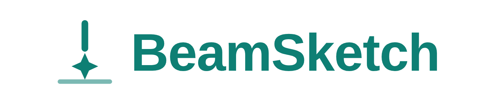
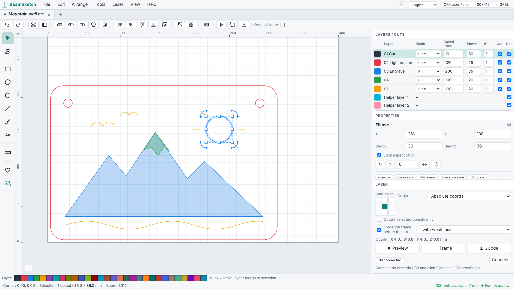
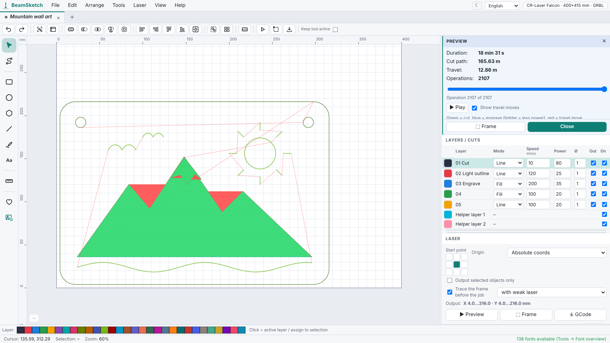
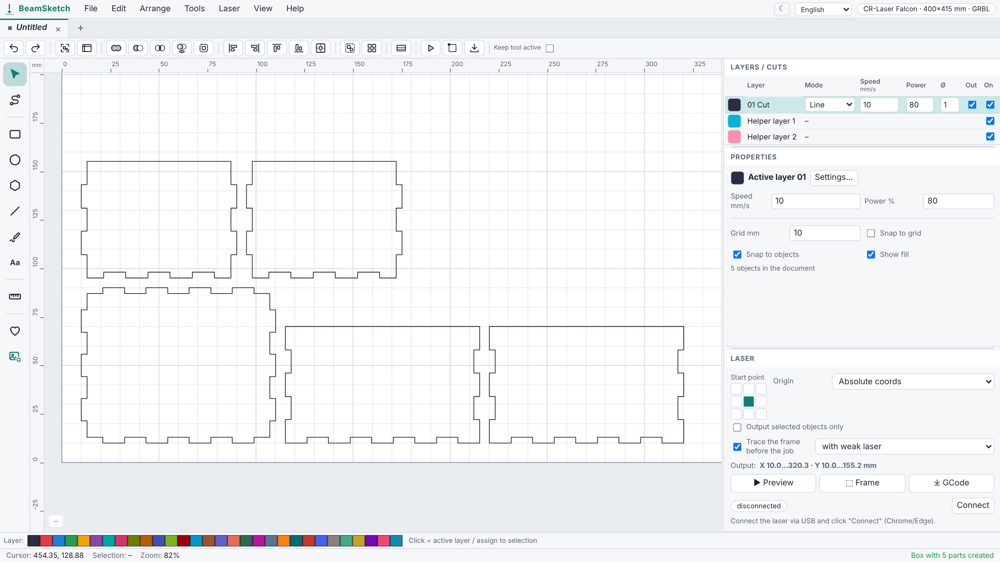
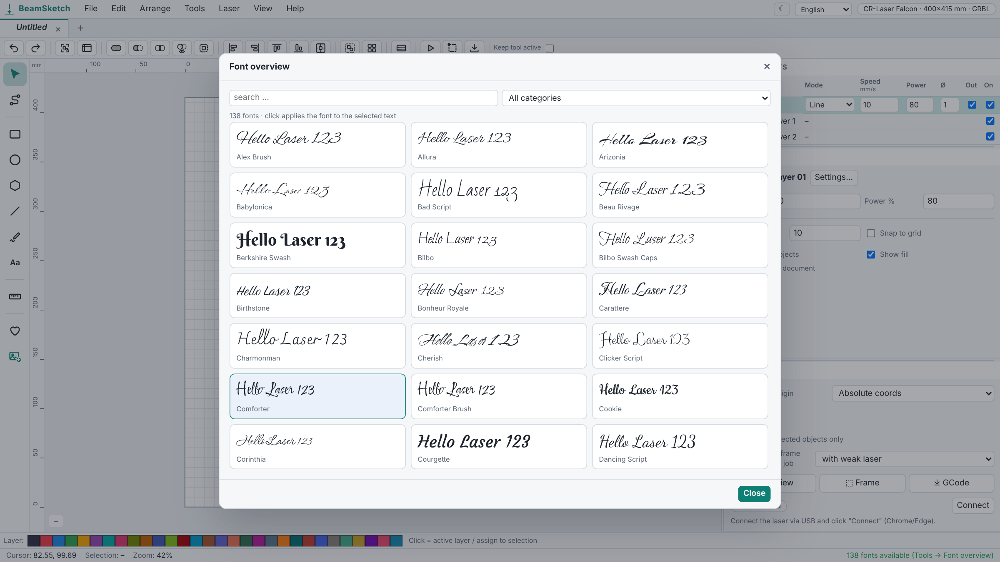
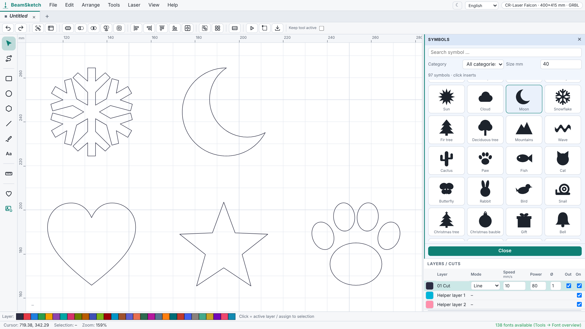
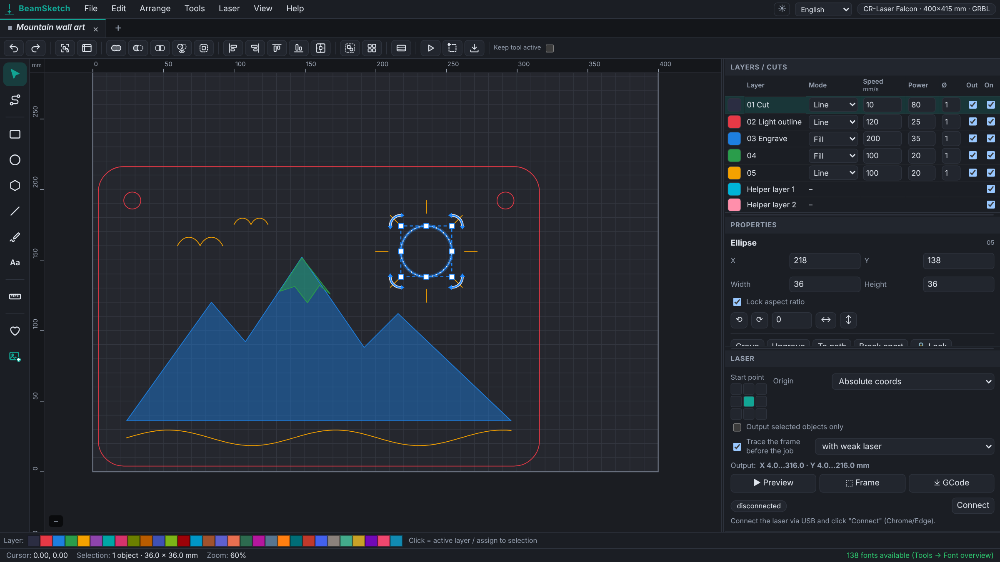
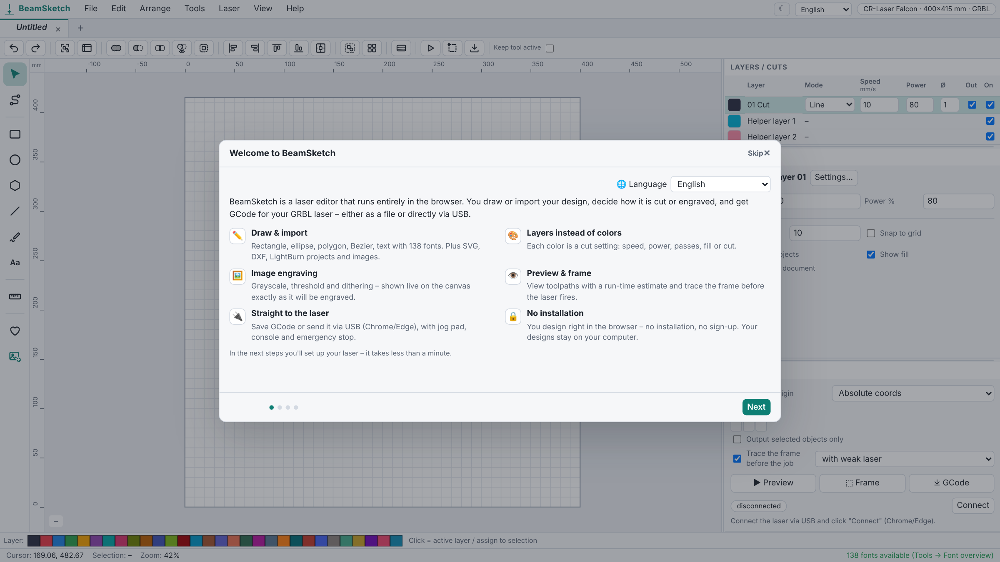
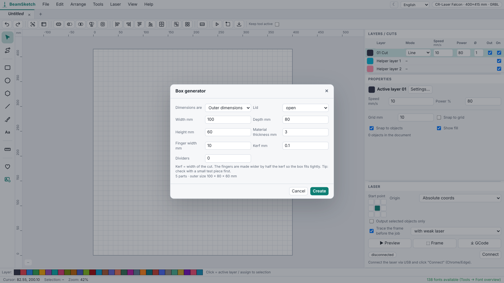

<p align="center">
  
</p>

<h3 align="center">The laser editor that runs in your browser</h3>

<p align="center">
  Design, engrave and cut with your GRBL laser – no installation, no account, no build step.<br>
  Draw or import, set cuts per layer, preview the toolpaths and send GCode straight to the laser over USB.
</p>

<p align="center">
  <a href="https://beamsketch.com"></a>
  <a href="LICENSE"></a>
  
  
  <a href="https://ko-fi.com/beamsketch"></a>
</p>

<p align="center">
  <a href="#features">Features</a> ·
  <a href="#quick-start">Quick start</a> ·
  <a href="#supported-lasers">Supported lasers</a> ·
  <a href="#contributing">Contributing</a> ·
  <a href="#license">License</a>
</p>



---

## Features

<table>
  <tr>
    <td width="50%" valign="top">
      <h3>Draw & import</h3>
      Rectangle, ellipse, polygon/star, polyline, bezier pen and text. Node editor, boolean operations,
      offset, align & distribute, arrays, snapping and an undo history of 200 steps with a history panel – it even survives a page reload.
      <b>Path tools</b>: warp, round/chamfer corners, close, join, reverse, set start point and trim.
      Guides dragged from the rulers, multi-page projects.
      Import <b>SVG</b>, <b>DXF</b>, <b>PDF</b>, <b>Illustrator</b> (<code>.ai</code>), <b>LightBurn</b> projects
      (<code>.lbrn</code>/<code>.lbrn2</code>) and images with tracing – outline or centerline.
      Export GCode, SVG, DXF and PDF.
    </td>
    <td width="50%" valign="top">
      <h3>Layers instead of colors</h3>
      Every color is a cut setting: line, fill, fill + line or offset fill – with speed, power, passes,
      interval, angle, cross-hatch, overscan, kerf, Z offset, air assist, M3/M4 and tabs.
      A material library keeps your favourite settings.
    </td>
  </tr>
  <tr>
    <td valign="top">
      <h3>Image engraving</h3>
      Grayscale, threshold and dithering (Floyd–Steinberg, Jarvis, Stucki, Atkinson, Sierra, ordered) –
      shown <b>live on the canvas</b> exactly as it will be engraved, with brightness, contrast and gamma
      sliders. Extra image modes <b>halftone raster</b> and <b>sketch</b>.
    </td>
    <td valign="top">
      <h3>Straight to the laser</h3>
      GRBL GCode with safety checks, a <b>design check</b> (duplicate lines, open outlines, thin bridges),
      toolpath preview with time estimate and framing.
      Connect over <b>USB (Web Serial)</b> with jog pad, homing, console, pause and stop –
      or save the GCode for the SD card. Also: <b>galvo lasers</b> (EZCAD2/BJJCZ) over WebUSB,
      <b>FluidNC/ESP3D over Wi-Fi</b> and a <b>rotary axis</b> (rollers or chuck).
    </td>
  </tr>
  <tr>
    <td valign="top">
      <h3>Generators</h3>
      Finger-joint boxes, living hinges, QR codes and Code&nbsp;128 barcodes, text on a path or circle,
      serial numbers from CSV, material and focus test patterns and true-shape nesting (parts in holes, rotation, scrap sheets).
      <b>Layered and rib models from STL/OBJ</b>: slice a 3D model into numbered sheets to stack, or into
      ribs that slot onto a spine, with a 3D preview.
      A <b>joint tool</b> adds finger joints, tabs and slots or cross-lap slots to any two straight edges.
      A <b>part generator</b> makes involute gears, gear pairs, racks, GT2/HTD pulleys, cams, box inserts,
      slot-together shelves and drawers – double-click a part to change its parameters later.
      The <b>3D view</b> shows boxes, drawers, shelves, inserts and gear pairs assembled, in different
      materials, with an exploded view and PNG export. Any drawing can be downloaded as an <b>STL</b> for
      3D printing, with a height per layer (e.g. a 3 mm plate with 5 mm raised lettering).
    </td>
    <td valign="top">
      <h3>162 fonts & 97 symbols</h3>
      Bundled fonts with real kerning – 92 of them connected script fonts – plus system fonts and your own
      <code>.ttf</code>/<code>.otf</code>. A symbol library with hearts, stars, animals, holidays and more.
    </td>
  </tr>
</table>

### See it in action

<table>
  <tr>
    <td width="50%"></td>
    <td width="50%"></td>
  </tr>
  <tr>
    <td align="center"><b>Toolpath preview</b> – duration, path length and travel moves before the laser fires</td>
    <td align="center"><b>Box generator</b> – finger joints, kerf compensation, lids and dividers</td>
  </tr>
  <tr>
    <td></td>
    <td></td>
  </tr>
  <tr>
    <td align="center"><b>Font overview</b> – 162 fonts (24 of them Arabic), click to apply</td>
    <td align="center"><b>Symbol library</b> – 97 ready-to-cut shapes</td>
  </tr>
</table>

<details>
<summary><b>More screenshots</b></summary>
<br>

<p align="center">Dark mode.</p>

<p align="center">The setup assistant picks your laser from a list of 62 models – or reads the real values from the controller.</p>

<p align="center">Box generator settings.</p>
</details>

### And also

- **Setup assistant** with a searchable list of 62 laser models; reads `$130`, `$131`, `$30`, `$110` … directly from the controller
- **Tabs** – several designs open at once, each with its own undo history
- **Camera overlay** – a webcam above the laser, calibrated with an engraved 3 × 3 or 5 × 5 grid of crosses (perspective and lens distortion corrected), shows the workpiece under your design (Laser → Camera…)
- **Print & Cut** – print a design with two registration marks, jog the head to both marks, and the cut lines are rotated and shifted onto the print
- **Jig for batches** – cut a board with pockets for your workpieces, then engrave the design into every pocket in one run
- **Fit calibration** – laser a test square and a slot comb, measure, and BeamSketch works out kerf and
  clearance for the joint tool, box and part generators
- **Rotary axis** – rollers or chuck on the Y connector; the design wraps around the object's circumference
- **Rotate handles** – quarter-circle handles on the selection corners, like you know them from other laser software
- **Multi-page projects** – several pages in one project (status bar or View → Pages…, `PageUp` / `PageDown`); laser and export work on the current page
- **Light and dark theme**, following your system on first start
- **14 languages** – English, German, Spanish, French, Italian, Portuguese, Dutch, Polish, Turkish, Russian, Japanese, Chinese, Korean, Arabic (right-to-left)
- **Private by design** – everything runs locally in your browser; your designs never leave your computer

## Quick start

**Online:** open **[beamsketch.com](https://beamsketch.com)** and click *Start now* – no sign-up needed.
(The hosted version adds an optional free account for online storage and AI tools; those parts are not
in this repository.)

**Locally:** you need [Node.js](https://nodejs.org) 18 or newer – there is nothing to install.

```bash
git clone https://github.com/FelixStopa/beamsketch.git
cd beamsketch
node serve.js          # → http://localhost:8080
```

Any static web server works too – BeamSketch is plain HTML, CSS and ES modules.

> [!NOTE]
> For the **USB connection** to your laser use **Chrome, Edge or Opera** on a desktop computer. Web Serial
> only works on `localhost` or over HTTPS. Firefox and Safari can do everything else – save the GCode and
> send it another way.

### From design to cut

1. Pick your laser in the setup assistant
2. Draw or import your design
3. Assign layers with the color palette at the bottom
4. Double-click a layer to set speed, power and passes (or use the material library)
5. Check the **Preview** – paths and run time
6. **Frame** the job to check the position on the material
7. **Save GCode** – or **Connect** and **Start**

## Supported lasers

| Controller | Status |
|---|---|
| GRBL / GRBL-LPC / grblHAL (almost all diode lasers) | ✅ save GCode **and** send directly via USB |
| FluidNC / ESP3D (ESP32 boards) | 🧪 new – send over Wi-Fi (WebSocket); needs BeamSketch served over http, e.g. `npm start` locally |
| Smoothieware (K40 conversions, Cohesion3D) | ✅ GCode |
| xTool D1 / D1 Pro | ✅ GCode (they behave like GRBL) |
| Galvo lasers with EZCAD2 / BJJCZ controller (fiber, MOPA, CO2 galvo) | 🧪 new – send directly via WebUSB, red-light framing |
| Marlin (3D printer / CNC with laser module) | ⚠️ limited – adjust the start GCode |
| xTool S1, Snapmaker 2.0 | ⚠️ limited – own protocol |
| Ruida (OMTech, Thunder …), Glowforge, xTool F1/M1/P2, LaserPecker, K40 with M2 Nano, EZCAD3 galvos | ❌ no GCode – drawing and SVG export work |

Creality Falcon, Ortur, Atomstack, Sculpfun, NEJE, Longer, TwoTrees, AlgoLaser, Mecpow, Wainlux, Comgrow, Acmer
and many more are in the device list (`devices/devices.json`). Missing yours? A pull request with the
model and its work area is very welcome.

## Keyboard shortcuts

| Key | Action | Key | Action |
|---|---|---|---|
| `V` / `N` | Select / edit nodes | `Ctrl+Z` / `Y` | Undo / redo |
| `R` / `E` / `P` | Rectangle / ellipse / polygon | `Ctrl+G` / `U` | Group / ungroup |
| `L` / `B` / `T` | Polyline / bezier / text | `Ctrl+K` | Symbol library |
| `M` | Measure | `Ctrl+M` | Material library |
| `0` / `1` | Fit all / fit work area | `Ctrl+E` | Save GCode |
| `Space` + drag | Pan | `Ctrl+H` | History |
| `PageUp` / `PageDown` | Previous / next page | | |

## Project structure

| Path | Content |
|---|---|
| `index.html`, `css/` | Page and styles |
| `js/main.js` | Application core: tools, commands, panels, dialogs |
| `js/geom.js` | Matrices, bezier, polygon booleans, offset, scanline fill |
| `js/doc.js` | Document model, shapes, layers, undo |
| `js/render.js` | Canvas rendering, rulers, selection, preview |
| `js/cam.js`, `js/gcode.js` | Toolpaths and GRBL GCode with time estimate |
| `js/raster.js` | Image engraving, dithering, live preview |
| `js/font.js` | Text to vector, font library, kerning |
| `js/svg.js`, `js/dxf.js`, `js/lbrn.js`, `js/formats.js` | Import/export (SVG, DXF, LightBurn, PDF/AI import, DXF/PDF export) |
| `js/serial.js` | Web Serial connection to GRBL |
| `js/galvo.js` | Galvo lasers (EZCAD2 / BJJCZ) over WebUSB |
| `js/mesh.js`, `js/model3d.js`, `js/ribs.js`, `js/view3d.js` | STL/OBJ import, layered and rib models, 3D preview (WebGL) |
| `js/assembly.js`, `js/view3dui.js` | 3D view of assemblies, STL export |
| `js/parts.js`, `js/partsui.js`, `js/joints.js`, `js/calibrate.js` | Part generator (gears, cams, shelves …), joint tool, fit calibration |
| `js/nest.js`, `js/check.js` | True-shape nesting, design check |
| `js/pathtools.js`, `js/pathtoolsui.js` | Warp, round/chamfer corners, close/join/reverse paths, start point, trim |
| `js/camera.js`, `js/printcut.js`, `js/jig.js` | Camera overlay, Print & Cut, jig for batches |
| `js/pages.js`, `js/centerline.js` | Multi-page projects, centerline tracing |
| `js/projects.js` | Tabs, saving projects |
| `js/symbols.js` | Symbol library |
| `js/features.js`, `js/generators.js`, `js/qrcode.js` | Generators and dialogs |
| `js/onboarding.js`, `devices/devices.json` | Setup assistant, laser models |
| `js/library.js`, `js/storage.js` | Material library, session in the browser |
| `js/ext.js` | Extension interface |
| `js/i18n.js`, `js/locales/` | Translations |
| `fonts/`, `vendor/` | Bundled fonts and opentype.js, with their licenses |

<details>
<summary><b>Extensions</b></summary>
<br>

The editor works on its own. A page can load extensions via
`<meta name="beamsketch-ext" content="/path/extension.js">`; each module exports `setup(App, helpers)` and
can add tools, menu entries, an online store for projects and symbols, or a per-account browser storage
area. The hooks are documented at the top of `js/ext.js`. beamsketch.com uses this for accounts, online
storage and the AI tools.
</details>

<details>
<summary><b>Translations</b></summary>
<br>

User-facing text is wrapped in `loc('…')`; the German original is the key. Translations live in
`js/locales/<lang>.js` – missing entries fall back to German. Placeholders: `loc('{n} objects', { n })`.
Improvements to existing translations are very welcome.
</details>

## Safety

Lasers can cause fires, burns and permanent eye damage. **Wear laser safety glasses, never leave the laser
unattended, ensure ventilation and keep a fire extinguisher at hand.** Never cut PVC or other
chlorine-containing plastics. You are responsible for checking the generated GCode and your machine
settings before running a job.

## Contributing

Bug reports, laser models, translations and code are all welcome – please read
[CONTRIBUTING.md](CONTRIBUTING.md) first. For bigger changes, open an issue so we can agree on the approach.

## Support

BeamSketch is free and will stay free. If it saves you time and you'd like to support its development, you can
buy me a coffee on [Ko-fi](https://ko-fi.com/beamsketch) – or simply leave a star on GitHub. Thank you!

## License

Copyright © 2026 Felix Stopa

BeamSketch is free software: you can redistribute it and/or modify it under the terms of the
**GNU Affero General Public License, version 3** – see [LICENSE](LICENSE). It is distributed in the hope
that it will be useful, but WITHOUT ANY WARRANTY.

If you run a modified version for others over a network, the AGPL requires you to offer them its source
code – change `SOURCE_URL` in `js/main.js` (shown in *Help → About*) to point to your version.

Bundled third-party parts keep their own licenses: the fonts in `fonts/` (SIL Open Font License 1.1 or
Apache License 2.0, see `fonts/LICENSES.md`) and opentype.js in `vendor/` (MIT). The galvo driver in
`js/galvo.js` follows the protocol implementation of [galvoplotter](https://github.com/meerk40t/galvoplotter)
by MeerK40t (MIT, see `vendor/LICENSE-galvoplotter.txt`). The 3D preview uses earcut by Mapbox in
`vendor/earcut.js` (ISC, see `vendor/LICENSE-earcut.txt`).

The name **BeamSketch** and its logo identify the official project and the service at beamsketch.com.
Please use a different name for modified versions you publish or host.
